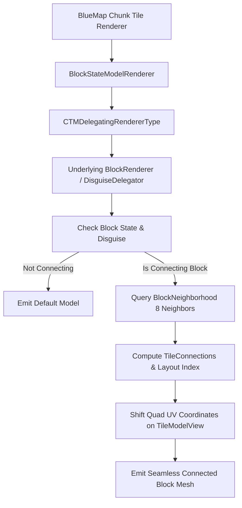

<div align="center">

# BlueMap CTM (Connected Textures Mod)

**Dynamic runtime Connected Textures (CTM / Fusion / Rechiseled) renderer for [BlueMap](https://github.com/BlueMap-Minecraft/BlueMap).**

[](https://www.minecraft.net/)
[](https://neoforged.net/)
[](https://adoptium.net/)
[](LICENSE)

</div>

---

## The Technical Problem

In modern Minecraft modpacks (such as those using **Rechiseled**, **Fusion**, **Create Connected**, or **Chipped**), connected texture blocks do not have static pre-baked blockstates in the world save (`.mca`). Every block in a connected wall or floor has the identical blockstate (e.g. `rechiseled:spruce_planks_tiles_connecting`).

In-game, client-side rendering engines (like Fusion) inspect the 8 neighboring blocks on each face at runtime, dynamically calculating UV sprite offsets across multi-tile sheets (e.g. 80x16 pieced layouts or 47-state full CTM sheets).

Because standard **BlueMap** tile rendering runs offline on the server reading only static blockstates and JSON models, it cannot evaluate runtime block connections. Without a runtime plugin, connected blocks either display only their un-connected standalone tile or compress an entire 80px multi-tile texture into vertical pinstripes.

---

## What BlueMap CTM Does

**BlueMap CTM** is a server-side NeoForge companion mod for BlueMap that hooks into the tile rendering engine at chunk generation time:

1. **3D Neighbor Inspection:** When rendering a block face, it queries the surrounding 8 blocks in the `BlockNeighborhood` using Fusion's exact directional orientation vectors (`up`, `right`, `down`, `left`, and 4 diagonals).
2. **Multi-State Layout Support:**
   - **Pieced Layout (80x16):** Full support for 5-tile horizontal sheets used by over 90% of Rechiseled connecting blocks (standalone, full interior, vertical column, horizontal beam, and cross).
   - **Corner / Edge Calculation:** Seamlessly maps edge and corner states.
3. **Disguise & Copycat Integration:**
   - Integrates with [**BlueMap Disguise**](https://github.com/TheAndromedaCat/bluemap-disguise).
   - When a copycat block (e.g. `copycats:copycat_board`) is disguised as a connecting block (e.g. `rechiseled:spruce_planks_tiles_connecting`), BlueMap CTM recognizes the disguise and connects the blocks seamlessly across your floors and walls.
4. **Zero Split-Package Conflicts:** Built strictly under its own namespace (`net.notaglitch.bluemap_ctm.*`), avoiding Java 9+ Module System collisions.

---

## How It Works



---

## Installation

1. Place `bluemap_ctm-0.1.0.jar` into your server's `mods/` folder alongside BlueMap.
2. If using disguised copycat blocks, also install `bluemap_disguise-0.1.0.jar`.
3. Restart your server. BlueMap CTM automatically hooks into BlueMap's `DEFAULT` BlockRenderer registry upon initialization.

---

## Building

```bash
./gradlew build -x test
```
The output jar will be in `build/libs/bluemap_ctm-0.1.0.jar`.

---

## License
MIT
